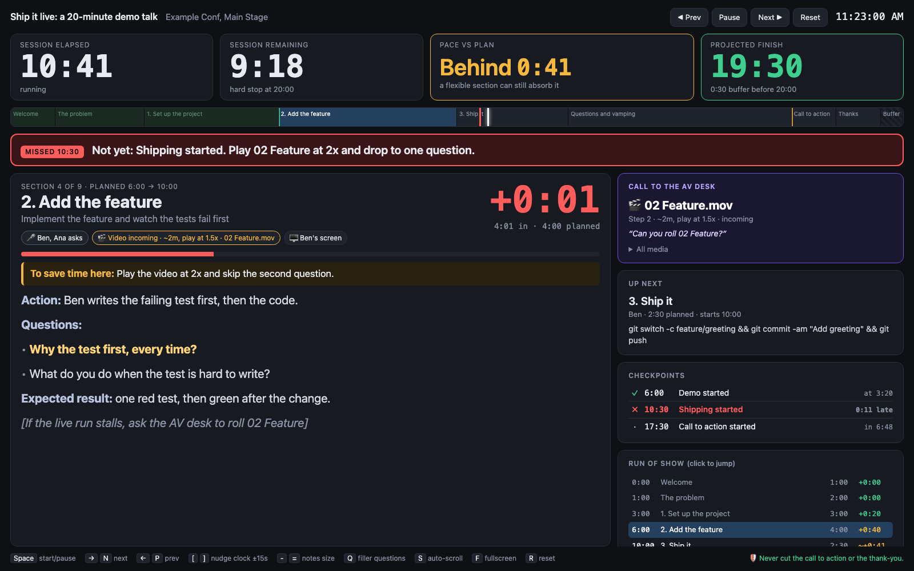

# session-pacer

A presenter view for timed talks, workshops and demo sessions. It shows your
speaker notes for the current section, counts up and down for both the
session and the section, tells you whether you're behind, and says what to
cut when you miss a checkpoint.



There's no build step, no dependencies, and nothing leaves your machine. It's
one HTML file plus a session file that describes your talk.

**[Try the live demo](https://kallewesterling.github.io/session-pacer/?session=example)**
(press `Space` to start the clock).

## Quick start

```sh
git clone https://github.com/kallewesterling/session-pacer.git
cd session-pacer
./start example
```

`./start` serves the folder on `http://localhost:8642` with Python's built-in
web server and opens your browser. Without Python, open `index.html`
directly and add `?session=example` to the URL.

To make your own talk:

```sh
cp sessions/example.js sessions/my-talk.js
./start my-talk
```

The last session you opened is remembered, so `./start` on its own reopens it.

## What it shows

- **Session clock.** Elapsed time, and time left to the hard stop.
- **Section timer.** A countdown for the section you're in. It turns amber
  near the end and red once you're over.
- **Pace vs plan.** How far behind or ahead you are: how late the current
  section started, plus any overrun of its planned length.
- **Projected finish.** When you'll finish if the rest goes to plan. A
  section with `hardEnd` (Q&A, say) stretches or shrinks to end at that time,
  so being late early on doesn't necessarily move the finish.
- **Checkpoints.** "Be at section X by time T". If you're on pace to miss one,
  an amber banner shows the plan B in advance. Once the time passes, a red
  banner shows the cut.
- **Cut hints.** When you're behind, the current section's own shortcut is
  shown above the notes.
- **Media cues.** The video or file for this section, a line to read out to
  the AV desk, the next file coming up, and a list of every file.
- **Auto-scroll.** Long notes scroll slowly as you'd be reading them, timed to
  the section's length. Scroll by hand and it holds until the next section.
- **Filler questions.** Press `Q` at any point to open a list of questions to
  fill time.

## Keys

| Key | Action |
| --- | --- |
| `Space` | Start / pause the clock |
| `→` `N` `PageDown` | Next section |
| `←` `P` `PageUp` | Previous section |
| `[` `]` | Nudge the clock by −15s / +15s (if you started it late) |
| `-` `=` | Smaller / larger notes |
| `Q` | Filler questions (`Esc` closes) |
| `S` | Auto-scroll on / off, or resume it after scrolling by hand |
| `F` | Fullscreen |
| `R` | Reset |

Click any section in the run of show, or on the timeline, to jump to it.
Presentation clickers that send PageUp and PageDown work too.

Your place in the session is saved in the browser's `localStorage`, so
reloading or closing the tab doesn't lose it. Press `R` after a rehearsal.

## Session files

A session is a JavaScript file in `sessions/` that sets `window.SESSION`. It's
JavaScript rather than JSON so notes can be multi-line template strings. See
[`sessions/example.js`](sessions/example.js) for a complete one.

```js
window.SESSION = {
  id: "my-talk-2026",          // localStorage key; change it to start fresh
  title: "My talk",
  event: "Some Conf, Room 2",
  total: "30:00",              // the hard stop
  neverCut: "Never cut the demo.",  // shown in the footer

  settings: {                  // all optional
    onTimeSeconds: 20,         // within this, you're "on time"
    badSeconds: 90,            // behind by more than this turns red
    labels: ["Action", "Expected result"],  // "Label:" prefixes to style
  },

  booth: {                     // optional: wording of the media card
    title: "Call to the AV desk",
    call: "“Can you roll {name}?”",   // {name} = file without extension, {file} = full name
    noMedia: "Nothing to roll",
  },

  sections: [ /* see below */ ],
  checkpoints: [ /* see below */ ],
  filler: `## Questions\n- What would you do differently?`,  // optional, opened with Q
};
```

### Sections

Start times are worked out from the lengths, so changing one length moves
everything after it.

| Field | | Meaning |
| --- | --- | --- |
| `step` | required | Title. A leading number (`"3. Demo"`, `"7 + 8. …"`) is used as the step number. |
| `length` | required | Planned length, `m:ss`. |
| `id` | | Needed if a checkpoint refers to this section. |
| `who` | | Who's speaking. |
| `what` | | One-line summary. |
| `notes` | | Speaker notes; see the formatting below. |
| `cutHint` | | What to shorten here when you're behind. |
| `hardEnd` | | `m:ss`. The section ends at this time no matter when it started (good for Q&A or "vamping"). |
| `isBuffer` | | Slack before the hard stop. Not counted in the projected finish. |
| `neverCut` | | Marks the section as protected. |
| `slide` | | Slide or screen cue, shown as a badge. |
| `media` | | `{ file, duration, status, alt }`. `status` is `ready`, `todo`, `incoming`, `live` or `video-only`. `alt` is a fallback. |

### Checkpoints

```js
{ at: "14:00", section: "demo", label: "Demo started", ifBehind: "Skip the second story." }
```

A checkpoint is met when you've reached `section` by `at`.

### Notes formatting

| Line starts with | Renders as |
| --- | --- |
| `> ` | A prompt or command to type, in a code block |
| `- ` | Bullet |
| `## ` | Subheading |
| `(…)` or `[…]` (whole line) | Stage direction, grey italics |
| `Label:` (from `settings.labels`) | Bold label |

Inline: `` `code` ``, `**bold**` (highlighted, for phrases to land) and bare
URLs.

### Keeping sessions private

`sessions/private/` is gitignored. Put real talks there and open them with
`./start private/my-talk`.

## Contributing

Issues and pull requests are welcome. The app is deliberately one file
(`index.html`) with no dependencies; please keep it that way unless there's a
good reason not to.

## Licence

[MIT](LICENSE)
